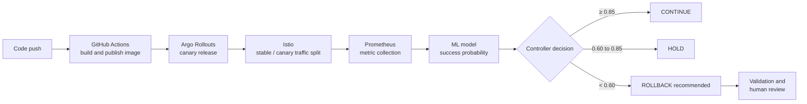
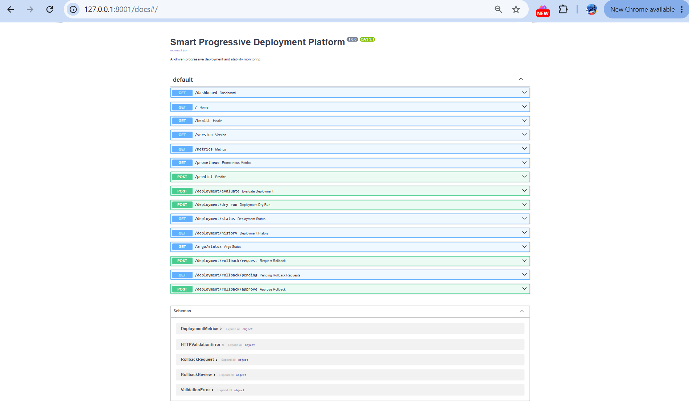
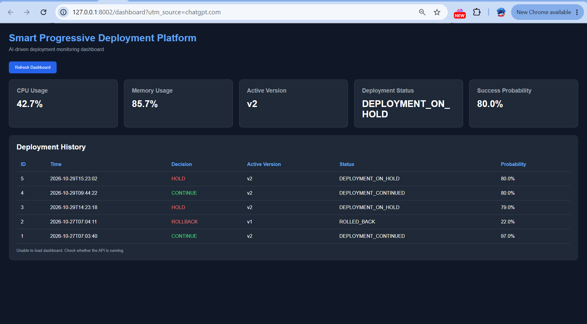
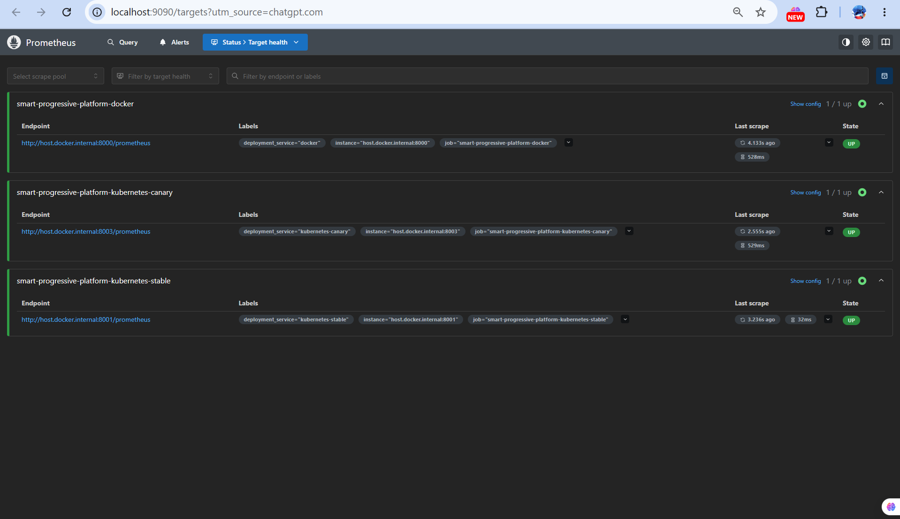
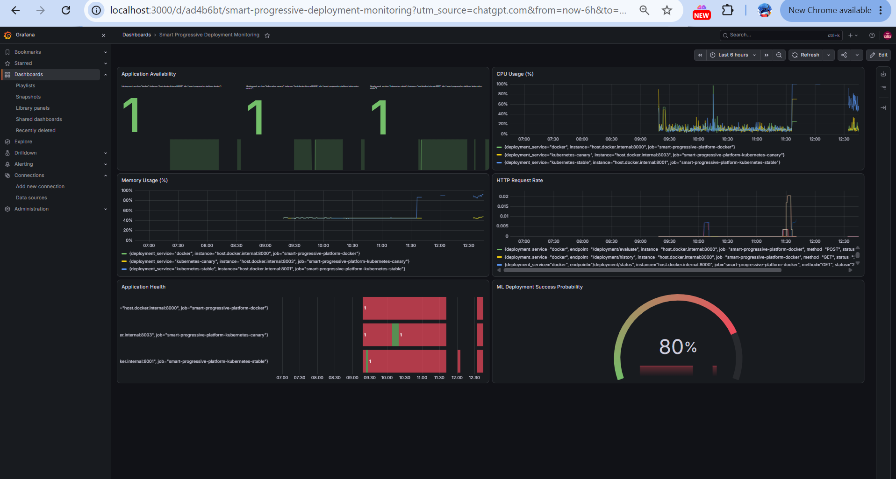

<div align="center">

# Smart Progressive Deployment Platform

### ML-Powered Canary Analysis with Human Approval and Rollback Support

*A final year capstone project on safer software releases through progressive delivery, observability, and machine-learning-assisted decision making.*

<br>


[Overview](#1-overview) ·
[Architecture](#3-system-architecture) ·
[Quick Start](#8-getting-started) ·
[API](#9-api-reference) ·
[Results](#6-verification-and-results) ·
[Limitations](#11-limitations-and-production-considerations)

</div>

## Table of Contents

1. [Overview](#1-overview)
2. [Objectives and Key Features](#2-objectives-and-key-features)
3. [System Architecture](#3-system-architecture)
4. [Methodology](#4-methodology)
5. [Component Walkthrough](#5-component-walkthrough)
6. [Verification and Results](#6-verification-and-results)
7. [Technology Stack and Repository Structure](#7-technology-stack-and-repository-structure)
8. [Getting Started](#8-getting-started)
9. [API Reference](#9-api-reference)
10. [Testing](#10-testing)
11. [Limitations and Production Considerations](#11-limitations-and-production-considerations)
12. [Future Work](#12-future-work)
13. [Authors and Acknowledgements](#13-authors-and-acknowledgements)
14. [License](#14-license)

---

## 1. Overview

### Problem statement

Releasing a new application version is risky. Manual judgment about whether a canary release is healthy is slow, subjective, and difficult to audit, and a bad release that reaches all users can cause outages. Threshold-only checks on single metrics also miss combined patterns, such as modest increases in latency, CPU, and error rate that are only concerning together.

### Proposed solution

This project is a progressive-delivery platform that evaluates a release while it is being rolled out. It collects application and deployment metrics (CPU, memory, latency, error rate, and traffic), passes them to a trained machine-learning model that estimates the **probability of deployment success**, and produces one of three recommendations: `CONTINUE`, `HOLD`, or `ROLLBACK`.

Rollback requests are validated and routed through a **human-review workflow** rather than executed automatically, keeping a person accountable for the final decision.

Kubernetes, Argo Rollouts, and Istio provide rollout orchestration and traffic control. Prometheus and Grafana provide monitoring.

---

## 2. Objectives and Key Features

### Objectives

- Automate canary health evaluation using a data-driven model instead of manual inspection.
- Integrate with standard cloud-native tooling (Kubernetes, Argo Rollouts, Istio) rather than a bespoke deployment system.
- Provide full observability of both the application and the decision process.
- Keep a human in the loop for any rollback action.
- Persist every evaluation so deployment decisions can be audited.

### Key features

| Capability | Description |
|---|---|
| ML-based evaluation | Predicts deployment success from CPU, memory, latency, error rate, and traffic |
| Progressive delivery | Manages canary releases with Argo Rollouts |
| Traffic management | Splits traffic between stable and canary services through an Istio `VirtualService` |
| Observability | Exposes Prometheus metrics, visualized in Grafana |
| API and dashboard | FastAPI endpoints with Swagger documentation and a browser-based dashboard |
| Rollback safeguards | Validates rollback requests and supports a human-review workflow |
| Dry-run mode | Evaluates a proposed action without executing it |
| Decision history | Stores evaluations and decisions in SQLite for auditing |

---

## 3. System Architecture

The diagram shows the overall flow from code change through image build, canary rollout, monitoring, ML evaluation, and the resulting deployment decision.

<p align="center">
  
</p>

### Decision flow



---

## 4. Methodology

### 4.1 Workflow

1. **Code change.** A developer updates the application and pushes the source code.
2. **Build.** GitHub Actions can build and publish the Docker image as part of the CI/CD workflow.
3. **Canary release.** Kubernetes and Argo Rollouts manage the progressive deployment.
4. **Traffic routing.** Istio directs traffic between the stable and canary services.
5. **Metric collection.** Prometheus collects live application and deployment metrics.
6. **ML evaluation.** The model estimates deployment success probability from the metric inputs.
7. **Decision.** The controller recommends continuing, holding for more observation, or rolling back. Rollback requests are subject to validation and human review.

### 4.2 Machine-learning component

- **Input features:** CPU usage, memory usage, latency, error rate, and traffic.
- **Output:** probability that the deployment is successful.
- **Training data:** a synthetic dataset produced by `dataset/generate_dataset.py` and stored in `dataset/deployment_metrics.csv`.
- **Training pipeline:** `ml/train_model.py` (scikit-learn); the trained model is serialized with joblib to `ml/deployment_model.pkl`.

### 4.3 Decision thresholds

| Prediction / condition | Recommendation |
|---|---|
| Success probability **≥ 0.85** and configured health checks pass | `CONTINUE` |
| Success probability **0.60 to below 0.85** | `HOLD` |
| Success probability **below 0.60**, or configured failure conditions met | `ROLLBACK` recommendation |

> **Note:** These thresholds are configured for demonstration and are not universal production values. The controller also considers configured metric limits and rollout health.

---

## 5. Component Walkthrough

### 5.1 FastAPI backend

Exposes prediction, health, deployment evaluation, rollout status, history, and rollback-review endpoints.

<p align="center">
  
</p>

### 5.2 Deployment dashboard

Presents deployment status, system metrics, prediction results, and deployment history in one place.

<p align="center">
  
</p>

### 5.3 Argo Rollouts

Manages the canary rollout. In the demonstration, the main rollout progressed through all configured stages and reached 100% traffic on the stable v5 release.

<p align="center">
  
</p>

### 5.4 Istio traffic splitting

Routes requests between the stable and canary services according to the configured `VirtualService` and rollout traffic weights.

<p align="center">
  
</p>

### 5.5 Prometheus

Scrapes application metrics from the Docker, Kubernetes stable, and Kubernetes canary targets. The application exposes metrics at `/prometheus`.

<p align="center">
  
</p>

### 5.6 Grafana

Visualizes availability, CPU and memory usage, request activity, application health, and ML deployment success probability.

<p align="center">
  
</p>

---

## 6. Verification and Results

Results observed during the project demonstration:

| Test / component | Observed result |
|---|---|
| Main Argo Rollout | Healthy, step 7/7 |
| Main deployment replicas | 5 desired, 5 ready, 5 available |
| Canary ML positive `AnalysisRun` | Successful at probability `1.0` |
| Canary ML negative `AnalysisRun` | Failed as expected at probability `0.79`, below the `0.85` threshold |
| Isolated Argo rollback test | Rolled back from v5 to v2; test rollout returned to Healthy |
| Git repository | Changes pushed to `main`; working tree clean at final verification |

> **Scope of the rollback test.** The actual Argo rollback was executed in the isolated `rollback-lab` namespace using a separate `rollback-demo` rollout. The main five-replica deployment was not rolled back. This verifies the Argo rollback mechanism. It is not evidence that the complete FastAPI human-approval-to-rollback path was tested end to end.

Raw outputs are available in [`evidence/`](evidence/).

---

## 7. Technology Stack and Repository Structure

### Technology stack

| Layer | Technologies |
|---|---|
| Backend and API | Python, FastAPI, Uvicorn |
| Machine learning | scikit-learn, pandas, NumPy, joblib |
| System metrics | psutil, Prometheus client |
| Containerization | Docker |
| Orchestration | Kubernetes |
| Progressive delivery | Argo Rollouts |
| Traffic management | Istio |
| Monitoring | Prometheus, Grafana |
| Persistence | SQLite |
| Testing | pytest, FastAPI TestClient |
| Source control and CI | Git, GitHub, GitHub Actions |

### Repository structure

```text
CCRG_PR1/
├── app/
│   ├── main.py                    # FastAPI application
│   └── dashboard.html             # Browser dashboard
├── backups/
├── data/
├── dataset/
│   ├── deployment_metrics.csv     # Generated synthetic dataset
│   └── generate_dataset.py
├── deployment/
│   ├── argo_manager.py            # Argo Rollouts integration
│   ├── controller.py              # Decision logic
│   └── database.py                # SQLite persistence
├── docs/                          # Screenshots and architecture diagram
├── evidence/                      # Captured test outputs
│   ├── actual-rollback-test.txt
│   ├── ml-canary-pass-test.txt
│   ├── ml-canary-fail-test.txt
│   ├── final-pods.txt
│   └── final-rollout.txt
├── kubernetes/
│   ├── analysis-run-ml-test.yaml
│   ├── analysis-run-test.yaml
│   ├── analysis-template.yaml
│   ├── deployment.yaml
│   ├── rollback-demo.yaml
│   ├── service.yaml
│   └── virtualservice.yaml
├── ml/
│   ├── deployment_model.pkl       # Trained model
│   └── train_model.py
├── monitoring/
│   └── prometheus.yml
├── tests/
├── Dockerfile
├── requirements.txt
└── README.md
```

---

## 8. Getting Started

### Prerequisites

- Python 3.13 or a compatible version
- Docker Desktop
- A Kubernetes cluster (Docker Desktop Kubernetes is suitable for local development)
- `kubectl`
- Argo Rollouts controller and the `kubectl-argo-rollouts` plugin
- Istio, when using the included traffic-routing configuration
- Prometheus and Grafana for monitoring

### Step 1: Clone the repository

```bash
git clone https://github.com/BVIPD/smart-progressive-deployment-platform.git
cd smart-progressive-deployment-platform
```

### Step 2: Create the Python environment

<details open>
<summary><b>Windows (PowerShell)</b></summary>

```powershell
python -m venv .venv
.\.venv\Scripts\Activate.ps1
python -m pip install --upgrade pip
pip install -r requirements.txt
```

</details>

<details>
<summary><b>Linux / macOS</b></summary>

```bash
python3 -m venv .venv
source .venv/bin/activate
python -m pip install --upgrade pip
pip install -r requirements.txt
```

</details>

### Step 3: Generate data and train the model

Skip this step if `ml/deployment_model.pkl` already exists.

```bash
python dataset/generate_dataset.py
python ml/train_model.py
```

The dataset is written to `dataset/deployment_metrics.csv` and the trained model to `ml/deployment_model.pkl`. The application expects the model at that path.

### Step 4: Run the FastAPI application

```bash
uvicorn app.main:app --host 127.0.0.1 --port 8002 --reload
```

| Service | URL |
|---|---|
| Dashboard | http://127.0.0.1:8002/dashboard |
| Swagger API documentation | http://127.0.0.1:8002/docs |
| Health check | http://127.0.0.1:8002/health |
| Prometheus metrics | http://127.0.0.1:8002/prometheus |

### Step 5: Build and run with Docker

```bash
docker build -t ccrg-platform:v1 .
docker run -d --name ccrg-platform-local -p 8000:8000 ccrg-platform:v1
```

Verify the container:

```powershell
# PowerShell
Invoke-RestMethod http://127.0.0.1:8000/health
```

```bash
# Linux / macOS
curl http://127.0.0.1:8000/health
```

If the container name or port is already in use, choose a different name or host port.

### Step 6: Inspect the Kubernetes rollout

After configuring the cluster and the required Argo and Istio components:

```bash
kubectl get nodes
kubectl argo rollouts get rollout ccrg-platform -n default
kubectl get pods -n default
```

Review the manifests, namespace, image names, ports, and your current Kubernetes context before applying resources to any cluster.

---

## 9. API Reference

| Method | Endpoint | Purpose |
|---|---|---|
| `GET` | `/` | Root endpoint |
| `GET` | `/dashboard` | Browser dashboard |
| `GET` | `/health` | Application health |
| `GET` | `/version` | Application version |
| `GET` | `/metrics` | JSON system and application metrics |
| `GET` | `/prometheus` | Prometheus exposition format |
| `POST` | `/predict` | ML deployment prediction |
| `POST` | `/deployment/evaluate` | Evaluate and record a deployment decision |
| `POST` | `/deployment/dry-run` | Evaluate a proposed action without executing it |
| `GET` | `/deployment/status` | Controller deployment status |
| `GET` | `/deployment/history` | Deployment decision history |
| `GET` | `/argo/status` | Argo Rollouts status |
| `POST` | `/deployment/rollback/request` | Validate and create a rollback request |
| `GET` | `/deployment/rollback/pending` | List pending rollback requests |
| `POST` | `/deployment/rollback/approve` | Review a pending rollback request |

For full request and response schemas, open the Swagger UI at `/docs`.

---

## 10. Testing

Run the automated test suite:

```bash
python -m pytest tests -q
```

Run a syntax check on the core modules:

```bash
python -m py_compile app/main.py deployment/controller.py deployment/argo_manager.py deployment/database.py
```

---

## 11. Limitations and Production Considerations

This is an academic project and a local demonstration environment. ML predictions are estimates that depend on the quality and representativeness of the training data. The demonstration dataset is synthetic, so reported test performance should not be interpreted as production reliability.

Before production use:

- [ ] Add authentication and authorization
- [ ] Secure reviewer identity for rollback approvals
- [ ] Protect secrets
- [ ] Validate rollback targets against an explicit known-good revision policy
- [ ] Add concurrency safeguards
- [ ] Test the full approval-to-execution workflow end to end
- [ ] Calibrate model thresholds using representative workload data
- [ ] Do not expose the API, Prometheus, or Grafana publicly without suitable access controls

---

## 12. Future Work

- End-to-end test of the FastAPI approval-to-Argo-rollback path
- Training and validation on real workload telemetry
- Role-based access control for reviewers
- Notifications (Slack or email) for pending rollback requests
- Helm chart for one-command installation
- Model monitoring and drift detection


<div align="center">

**Smart Progressive Deployment Platform**
*Safer releases through progressive delivery, observability, and ML-assisted decisions.*

</div>